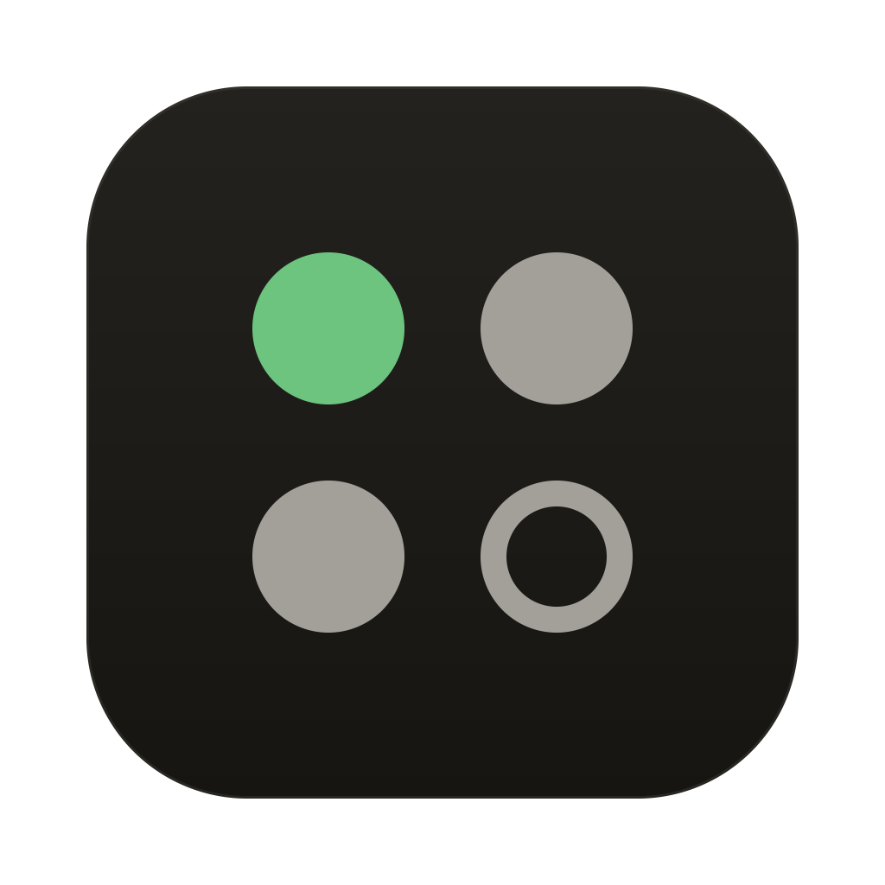
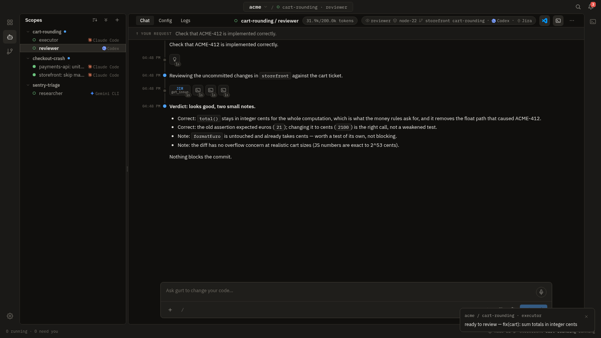
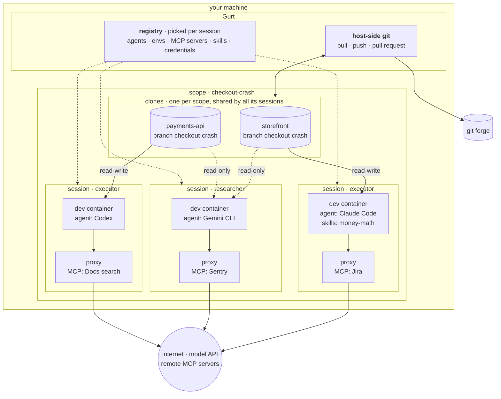
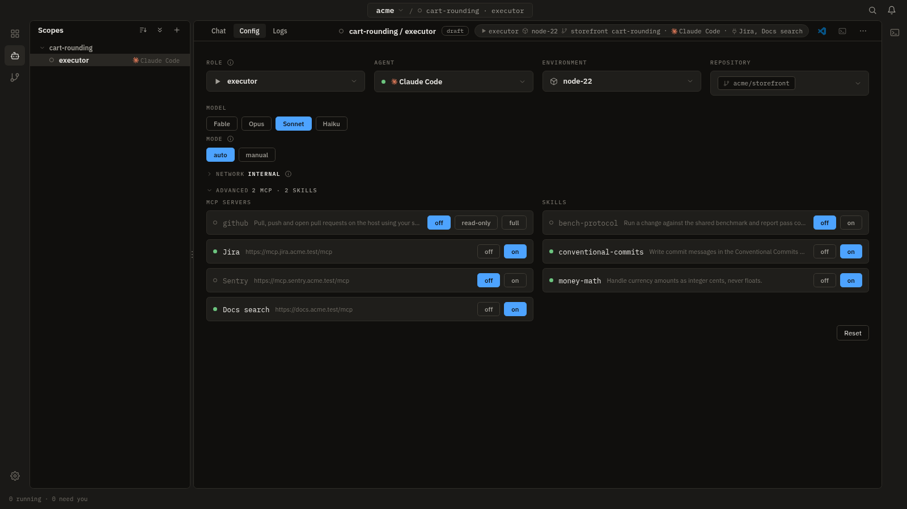
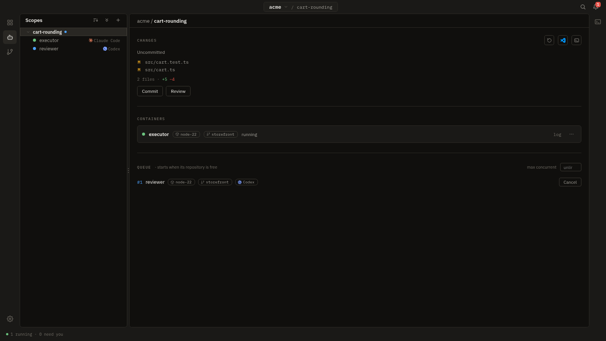
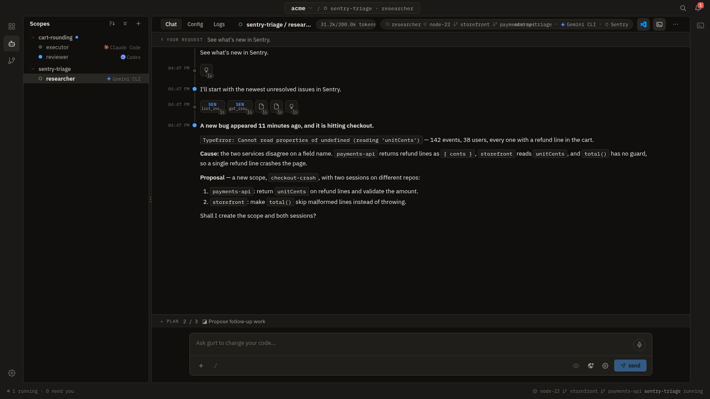
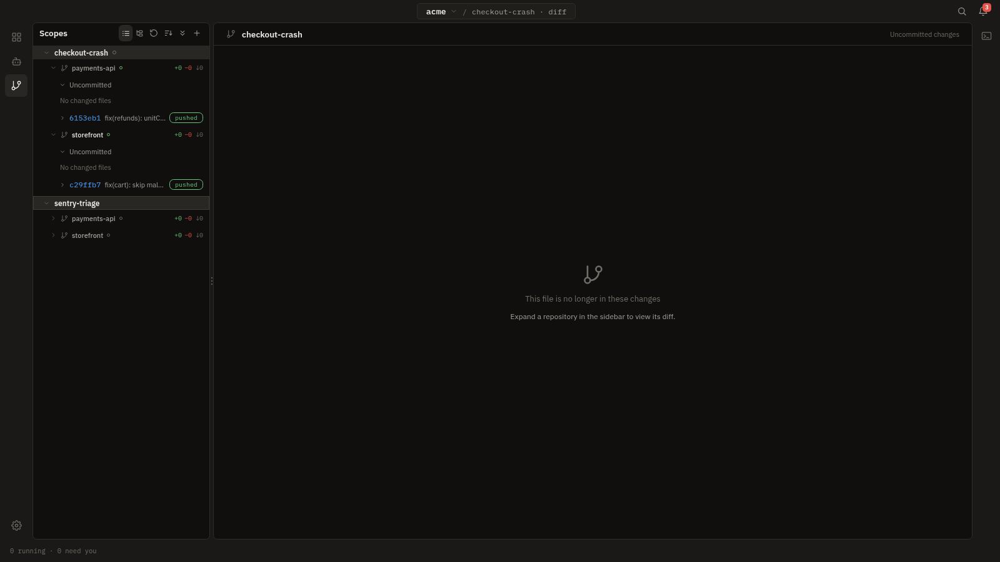
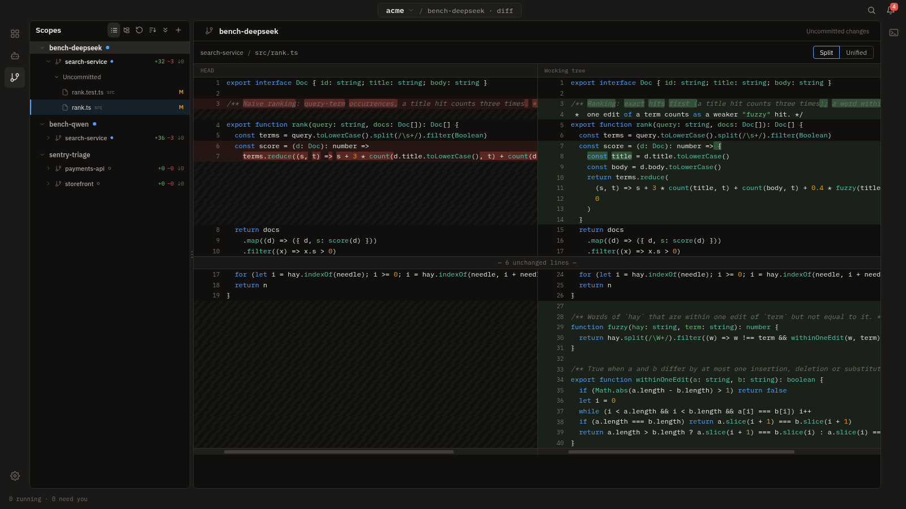

# Gurt

**Run coding agents in isolated containers on your own machine, with a queue, a review step and control over what each agent can reach.**

[Install](#install) · [Quick start](#quick-start) · [Concepts](#concepts) · [Security model](#security-model) · [Docs](#documentation)

Gurt is a local-first desktop app (Electron). Each agent session gets its own dev container, its own Docker network and its own proxy. Your repositories and git credentials stay on your machine. The name is a transcription of the Ukrainian «гурт» ("group").

It is for developers who already use a coding agent daily and worry about what it can touch, and for people running several agents at once who are tired of them trampling one working tree. It is not for teams that want a hosted service or central administration: Gurt is a single-user app with no server.

## Why Gurt

- **One container per session.** Every session runs in its own dev container, created on first start and destroyed with the session. Containers are never shared or reused between sessions.
- **Git credentials stay on the host.** Pull, push and pull requests run on the host. The container gets plain local git and never sees a git token. Gurt uses your own SSH keys or `gh` login only for a repo you explicitly link to a "host credentials" entry, never as a fallback.
- **No two agents on one working tree.** A writing session holds its clone while it runs. Another session for that clone waits in the queue until the clone is free. Writers on one repo therefore run one after another.
- **Several repositories at once.** A scope can hold clones of several repositories. Executors on different repos of one scope run side by side. A researcher reads several repos in one session and can draft the follow-up work, one session per repo.
- **Any agent through one UI.** Claude Code, Codex, Gemini CLI, opencode and Pi all use the same chat, permissions, queue and review flow.

## How it fits together

- A **scope** owns its clones: each repository it uses is cloned once for the scope, on a branch named after the scope, under `~/.gurt/` on the host. Every session of the scope works on these same clones.
- A **session** is a dev container. It mounts the subset of the scope's clones that its role allows: an executor gets one clone read-write, and a researcher gets any number read-only. It runs the agent you picked from Gurt's registry, with the skills you picked mounted read-only.
- Every session has its own **proxy**. The agent reaches its chosen MCP servers only through that proxy. The proxy also carries the session's network traffic, and in `internal` mode (the default for new sessions) it is the only way out. Built-in and local stdio MCP servers run on the host; remote ones are reached over HTTP with their token added at the proxy.
- Pull, push and pull requests run **on the host**, from the clones. No git credential is ever passed into a container.

Details: [docs/architecture.md](docs/architecture.md).

## What it looks like

<table>
  <tr>
    <td width="50%"></td>
    <td width="50%"></td>
  </tr>
  <tr>
    <td><b>Per-session setup.</b> Role, agent, env, repo, model, network, MCP servers and skills.</td>
    <td><b>The queue.</b> A Codex reviewer waits until the executor releases <code>storefront</code>.</td>
  </tr>
  <tr>
    <td></td>
    <td></td>
  </tr>
  <tr>
    <td><b>One researcher, two repos.</b> It reads <code>storefront</code> and <code>payments-api</code> and proposes a session for each.</td>
    <td><b>One scope, two repos.</b> Two executors worked side by side, and both branches are pushed.</td>
  </tr>
  <tr>
    <td></td>
    <td></td>
  </tr>
  <tr>
    <td><b>Review.</b> A split diff of the agent's uncommitted changes before you commit and push.</td>
    <td><b>Second opinion.</b> A reviewer on another agent judges the changes, and a notification says they are ready.</td>
  </tr>
</table>

Screenshots show the real app, driven by a scripted demo agent working on a made-up company's repos.

## Features

**Agents**
- Claude Code, Codex, Gemini CLI, opencode and Pi. You can add several instances of one kind, each linked to its own credential.
- Sign in through the provider's browser flow (Claude Code, Codex, Gemini CLI), or paste an API key (required for opencode and Pi).
- Roles: **executor** writes code and proposes a commit, **researcher** reads any number of repos and answers in chat, **reviewer** judges a clone's uncommitted changes, **operator** reads and edits Gurt's own configuration (risky changes wait for your confirmation).

**Per session**
- MCP servers picked per session: the built-in GitHub server (off, read-only or full), remote HTTP servers and local stdio servers.
- Skills (`SKILL.md` directories) picked per session and mounted read-only into the container.
- Environments are definitions stored in Gurt (an image or a Dockerfile, environment variables, a setup script and a start script). Sessions start on the base image (Settings → Environments), which any environment can replace as the default.

**Workflow**
- Queue: a new session is a draft until you press **Run**. Run always goes through the queue: the session starts at once if nothing is in the way, and waits otherwise. The lock is per clone, so sessions on different repos run in parallel. You can cap concurrent sessions per scope. The queue survives a restart.
- Plan limits: once an account's subscription window reaches the threshold (Settings → Clients, default 95%), nothing new starts on it. Queued sessions and queued messages wait for the reset, and a session the limit cut off sends "continue" on its own afterwards. Extra usage and credits lift the hold.
- Review: the split diff of the agent's changes. Then commit, push and open a pull request. Local repos with no forge yet use "Merge into main".
- [Review loop](docs/requirements-review-loop.md): an executor draft can opt in to a loop that runs the repo's check command, has a read-only reviewer on another agent or model review the change, lets the executor fix what it agrees with for up to N rounds, and on a clean result optionally commits, pushes or opens a draft PR (never merges on a forge). Off by default; set per draft in the Config tab, with defaults per repo in Settings → Repos. A running loop does not survive an app restart yet.
- [Proactive agents](docs/design-proactive-agents.md): an agent that runs on a schedule, reads its sources through MCP (Sentry, a tracker, mail) and raises scopes with draft sessions for you to launch. Each source item is bound to at most one scope, so repeated runs do not raise the same thing twice.
- [Files](docs/files.md): browse a scope's repositories and edit files in CodeMirror tabs, with syntax highlighting, explicit saves and JS/TS definition/reference navigation.
- Terminals on the host, opened per scope.

**Network and data**
- A proxy per session, with a network mode (`internal` by default, or `open`), an allow list of hosts, and a traffic panel that lists blocked hosts first.
- Git credentials (tokens) are stored by Gurt and sealed with the OS keystore where one is available.
- PII and secret masking before text reaches the agent: a built-in pattern detector or Presidio.

**Overview**
- In-app notifications when a session needs input, has changes to review, fails or finishes a turn. Each type can be switched on or off.
- Dashboard: agent plan-limit windows, a board of sessions across workspaces, and a turn ledger.

## Install

Download a build from [Releases](https://github.com/klerik3d/gurt/releases/latest). All builds are **alpha**.

- **macOS**: `.dmg`. If macOS refuses to open an unsigned build, run `xattr -dr com.apple.quarantine /Applications/gurt.app`.
- **Linux**: `.AppImage` or `.deb`. Only the AppImage updates itself. The deb upgrades through apt/dpkg.
- **Windows**: no build is published, and it is untested.

**Prerequisite: Docker.** You need the Docker CLI and a running daemon, and Gurt checks for both on first launch. To build from source, see [docs/development.md](docs/development.md).

## Quick start

1. Start Docker and launch Gurt. The welcome screen checks the Docker CLI, the daemon and the images. **Prepare** pulls any missing images.
2. Pick an agent kind. Then either **Sign in with …** or paste an API key ("or paste an API key instead"). The key is stored in this machine's credential store.
3. Gurt creates a workspace, a scope and an **operator** session, and starts it. The operator holds no repository. It reads your configuration, tells you what to fix, and can make the change itself; changes that would run code on the host wait for your confirmation.
4. In Settings → Repos, add a repository. For pushing, add a GitHub token in Settings → Credentials. A repo with no env of its own runs on the base image.
5. Create a new session (command palette → "New session…"). It starts as a draft. On its Config tab choose role **executor**, the env, the repo and an agent, write the first prompt, and press **Run**.
6. When the agent finishes with changes, open the **Diff** view in the activity bar. Review the diff, then **Commit changes…** and **Push changes**.

## Concepts

- **workspace**: the top-level divider. It has its own repos, envs, MCP servers and skills.
- **scope**: one unit of work in a workspace. It can span several repos; each is cloned once for the scope, on a branch named after the scope, and all sessions of the scope share those clones.
- **repo**: a registered git repository (URL plus a credential link), or a local repo that Gurt keeps until you publish it.
- **env**: an image-or-Dockerfile definition stored in Gurt. It is a template, so any number of sessions can run the same env.
- **agent**: an instance of a built-in kind, linked to its credential. Settings lists agents under **Clients**.
- **session**: one agent with one role, in one container, with one chat. A session goes `draft → queued → starting → started`.
- **role**: what a session is for: executor, researcher, reviewer or operator. The role sets mounts, the clone lock and tools.

Terminology: the UI says *scope*, while the code, the on-disk layout (`~/.gurt/<workspace>/<task>/`) and the older design documents say *task*. One Settings hint for local repos still says "tasks". The activity bar names the three work views **Agents**, **Diff** and **Files**. The old README and some notes call the first two Scope and Git modes.

## Security model

What Gurt enforces:

- Each session has its own container, Docker network and proxy. Sessions of one scope do share its clones, and each session mounts only the clones its role allows.
- A researcher's repos are mounted with Docker `readonly` bind mounts. This is enforced, not a convention.
- Git credentials never enter a session container, and authenticated git runs on the host. For remote MCP servers the container gets a URL and an opaque per-session token, and the real token is added at the proxy.
- New sessions start in **`internal`** network mode: the session network has no route out, and the proxy is the only way out. The proxy filters by one allow list. An empty list (the default) allows everything except this machine. A non-empty list allows only the hosts it names (`host` or `host:port`).
- While the allow list is empty, the proxy refuses traffic to this machine: loopback, link-local, `host.docker.internal` and private ranges. It checks the resolved address and dials that same address.
- If the masking detector is unavailable, the turn ends with an error instead of sending text unmasked.

What it does not enforce:

- **`open`** network mode (opt-in per session, for example for SSH git) is visibility, not enforcement. A process that ignores `HTTP_PROXY`/`HTTPS_PROXY` bypasses the proxy entirely.
- A host you name in the allow list is dialled by name, without the address check. Naming any host also turns off the built-in refusal of this machine.
- Setup always runs on the open network: the image build, the setup script and the adapter install.
- The agent's own API key or token is passed into its container as an environment variable.
- A reviewer's clone is currently writable, so it can install dependencies and run tests. Only the researcher's mounts are read-only.
- Local stdio MCP servers run on the host, unsandboxed.
- Masking covers prompt text, MCP traffic, and the file and terminal calls an adapter routes through Gurt. It does not cover HTTPS requests the agent makes itself, or what it does inside its container without going through Gurt. The model provider still sees everything that is sent after masking.

Details: [docs/architecture.md](docs/architecture.md). Supply-chain surface and vulnerability reporting: [SECURITY.md](SECURITY.md).

## Limits

- Alpha software (version 0.1.0).
- macOS and Linux are the primary platforms. Windows is untested and has no published build.
- Docker is required, and no session can start without a running daemon.
- Single user, single machine. All state lives under `~/.gurt/`, with no server, accounts or shared admin.
- Containers have no authenticated git and no SSH. Remote git runs on the host, with a token or, if you opt in per repo, the host's own SSH keys or `gh` login.
- Git tokens are verified against GitHub only (github.com and GitHub Enterprise hosts). GitHub is the only forge provider today.
- MCP servers do not reach Pi sessions yet: its ACP adapter ignores them.
- Notifications are in-app only. External delivery (Slack, email, webhook, OS push) is a stub.

## Documentation

- [Architecture](docs/architecture.md): the model, how a session starts, ACP, MCP, skills, network, git credentials, masking, the queue.
- [Development](docs/development.md): running from source, the dev container, tests, packaging, auto-update.
- [Client settings](docs/client-config.md): Claude Code attribution and opencode/OpenRouter.
- [Logging](docs/logging.md): the local app log under `~/.gurt/logs`.
- [Design notes and specs](docs/README.md): the documents Gurt was built from.

## Contributing

See [CONTRIBUTING.md](CONTRIBUTING.md). Contributions require signing the [CLA](CLA.md).

## Security

Report vulnerabilities privately. See [SECURITY.md](SECURITY.md).

## License

Licensed under the [Apache License 2.0](LICENSE). The project name and logo
are not covered by this license.
