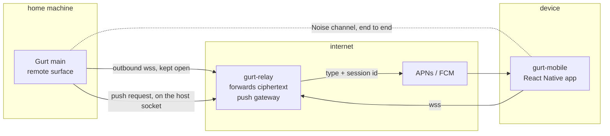

# Requirements: remote access through an end-to-end encrypted relay

Status: proposed — nothing implemented · Target: gurt Electron app (this repo),
a relay and push gateway (`gurt-relay`), a React Native app (`gurt-mobile`)

This document is a work order for an implementing agent. Read
`architecture.md` first, then `requirements-session-operator.md` §3 (the
exposure annotation on `src/shared/api.ts` that the remote surface sits
next to), `requirements-session-log.md` (the `seq` this document's reconnect
rides on) and `requirements-notifications.md` §5 (the external-delivery seam
§8 fills). What the app is for, screen by screen, is `design-mobile-app.md`.
The wire contracts between Gurt, the relay and the app — frames, handshakes,
messages, error codes — are in `requirements-remote-protocol.md`; where the
two disagree, that document wins.

Key code: `src/shared/api.ts` (`GurtApi` — the surface the remote API is
*not* a mirror of), `src/main/ipc.ts` (the IPC binding and its event
forwarding), `src/main/adminSurface.ts` (a second, filtered binding — the
pattern for how a surface calls into main), `src/main/notify-external.ts`
(the stub §8 replaces), `src/main/credentials.ts` (where host secrets are
kept), `src/main/jsonrpc.ts` (the JSON-RPC peer §6.4 reuses).

## 1. Motivation, constraints and decisions

The user starts a session at the desk, walks away, and the agent stops on a
permission prompt, finishes a turn, or hits a plan limit. Today the answer
is "come back to the computer". The goal is to watch sessions and act on
them from a phone, over the internet.

Three constraints from the owner shape everything below:

1. **It is for every user**, not a setup for one person. It must work
   behind home NAT and carrier-grade NAT with no router configuration.
2. **No VPN.** No Tailscale, WireGuard, ZeroTier or similar on either end.
3. **No third party sees plaintext.** Not a tunnel provider, not our own
   relay, not a push service. Everything that leaves the home machine is
   encrypted to a key only the user's paired device holds. (Push is the one
   place that also carries metadata; §2 A5, §8.)

And the product decisions, taken by the owner:

- **The client is a native app written in React Native** (Expo, with
  development builds so native modules are allowed), distributed through the
  App Store and Google Play. It is its own small UI on a small, versioned
  remote API — **not** the desktop renderer served to a phone, and not a
  mirror of `GurtApi`. `design-mobile-app.md` is its design.
- **One relay for all users.** The project operates a single relay in its
  own repository, `gurt-relay`. Its address is a setting in Gurt, and the
  QR code hands that address to the app. Running one's own relay is
  possible but needs one's own build of the app (own push credentials,
  §8.3); it is not a goal for now.
- **The relay is also the push gateway.** A native app is reached by APNs
  and FCM, whose credentials cannot ship in every Gurt install, so Gurt
  asks the relay to send the push (§8).
- **No approval from the notification itself**; diffs and the real values
  of masked text are shown on the phone (`design-mobile-app.md` §5.4, §5.6,
  §3.2).

Constraints 1 and 2 together mean the home machine dials out and a client
reaches it through something both can reach: a relay. Constraint 3 means
the relay forwards ciphertext and the channel is end-to-end encrypted
between Gurt and the device.

## 2. Threat model

Adversaries, in the order the design has to answer them:

- **A1 — the relay and the network.** Whoever runs the relay (here: the
  project, for every user) and anyone on the path. Must not read or alter
  traffic, and must not be able to impersonate either end. *Can* see
  metadata: IP addresses, host ids, connection times, message sizes and
  timing, and — because it sends pushes — which host has which devices and
  when a push goes out. Metadata is accepted, not defended (§13 Q3). One
  operator seeing the metadata of every user is the cost of the shared
  relay and is stated in `gurt-relay`'s README.
- **A2 — whoever ships the app.** The app holds the device key and shows
  decrypted chat; a malicious build or a compromised store account could
  exfiltrate. This is the same trust a user places in any app from a store:
  signed binaries, reviewed releases, the code open source. It replaces the
  PWA origin of the earlier design, which had to be trusted on every load,
  with a trust taken once per release. The app has no auto-updating code
  outside the store (no over-the-air JS updates, §7.3).
- **A3 — a lost or stolen device.** Can do whatever a paired device can
  until it is revoked. Bounded by §6 (what the remote API offers at all),
  by the app lock (`design-mobile-app.md` §5.6) and by revocation from the
  desktop (§5.3).
- **A4 — anyone on the internet who learns a host id.** Can connect to
  the relay and send handshakes. Must get nothing: a handshake from an
  unpaired key is rejected before any API is reachable, cheaply enough
  that it is not a DoS lever on the home machine (§4.3).
- **A5 — push services** (Apple, Google) **and the relay as sender.** See
  the push payload: a notification type and an opaque session id, plus the
  device token (§8). No titles, no chat text. Making even that opaque is
  §13 Q9.
- **A6 — abuse of the shared push gateway.** A host, or anyone posing as
  one, using the relay to spam devices it did not pair. A host can only
  push to device tokens it registered itself, over its authenticated
  socket, and the tokens reach it only from paired devices (§8.2).

Out of scope: a compromised home machine, or a compromised device OS.
Either already has everything.

## 3. Shape

Three repositories:

| Repository | Holds |
| --- | --- |
| `gurt` (this one) | the remote surface and channel in Gurt main (`src/main/remote/`), the Settings → Remote access page, the shared protocol package (`packages/remote-protocol`, published as `@gurt/remote-protocol`, §13 Q8), these documents |
| `gurt-relay` | the Go relay and push gateway, its README, the conformance vectors for the frame codec |
| `gurt-mobile` | the React Native app |

Four parts, each a section below: the relay (§4), the channel and pairing
(§5), the remote surface in Gurt main (§6), the app (§7). Plus push (§8)
and reconnect (§9).

## 4. The relay

### 4.1 A forwarder, and a push sender

A small Go service in `gurt-relay`. It holds no accounts, no device lists,
no keys of either end, and no state that survives a restart. It knows
*host ids*, *streams* and, in memory, the push tokens each host last told it
about (§8.2):

- A Gurt instance opens one long-lived `wss` connection and registers a
  host id (§4.2).
- A client opens a `wss` connection naming a host id. The relay allocates
  a stream id and from then on forwards opaque frames between the client
  socket and the host socket, tagged with that stream id.
- Frames: `open`, `data`, `close` per stream. One Noise message is one
  `data` frame. The exact contract is `requirements-remote-protocol.md`
  §3–§4.
- Push frames on the host socket (§8) make it send a native push.

The relay never takes part in the Noise channel, so Go here does not split
the crypto: Noise stays TypeScript at both ends (§5.1). The relay needs
WebSocket, TLS and Ed25519 (§4.2), plus an APNs and an FCM client — all in
Go's standard library or small dependencies.

The relay URL is a setting; Gurt does not depend on one particular
instance, and ships with the project's as the default.

### 4.2 Host registration

Each Gurt install has an Ed25519 *relay identity* key, separate from its
Noise key. `hostId` = base32 of the first 20 bytes of SHA-256 of the
public key. To register, the relay sends a random challenge and Gurt signs
it; the relay checks the signature against the claimed id.

This stops someone else registering the same host id and blackholing the
user's connections, and it is what authorises a host's push requests (§8.2).
It is **not** what protects the traffic — an impostor host could not
complete a handshake anyway, because it lacks the host's Noise static key
(§5). It is why the relay needs no account system.

### 4.3 Abuse limits

The relay cannot tell a paired client from a stranger — that knowledge is
deliberately only on the host. So: per-IP connection and frame-rate
limits, a cap on open streams per host id, an idle timeout on streams that
have not carried a frame, and a rate limit on pushes per host (§8.2).
Defaults are sized for many households sharing one instance. On the host, a
stream whose first message is not a valid handshake from a known device key
is closed after that one message, with no reply beyond the close.

### 4.4 Protocol version

- **One wire protocol, versioned.** The relay announces its protocol
  version at registration. Gurt refuses a relay it is too new or too old
  for and says which protocol version it needs, instead of failing
  obscurely.
- **`gurt-relay/README.md`** says how to run it and what the relay can see
  (§2 A1), so the user knows what they are trusting.
- **The relay serves no code.** There is no PWA to host.

## 5. The channel and pairing

### 5.1 Crypto

Noise Protocol Framework, `25519_ChaChaPoly_BLAKE2s`, built on the audited
`@noble/curves`, `@noble/ciphers` and `@noble/hashes` (pure JS, identical in
Electron main and in React Native's Hermes; no native module). Hermes has no
`crypto.getRandomValues` of its own, so the app installs a secure-random
polyfill backed by the OS before anything else loads; a Noise implementation
that falls back to `Math.random` is a bug. Either a vetted Noise
implementation over those primitives or a small one written here with the
Noise spec's test vectors as unit tests — §13 Q5.

Keys:

- **Host Noise static key** (X25519), generated once, stored with the
  other host secrets (`credentials.ts`).
- **Device static key** (X25519), generated in the app at pairing and kept
  in the iOS Keychain / Android Keystore-backed secure store, not synced or
  backed up (`WHEN_UNLOCKED_THIS_DEVICE_ONLY` or the platform equivalent).
  Losing the phone's secure storage means pairing again.
- The host keeps the list of paired devices: public key, a name the user
  gave it, paired-at, last-seen, push token.

Handshakes:

- **Pairing:** `Noise_IKpsk1`, with the one-time pairing secret from the QR
  code as the PSK and the host id in the prologue. The device knows the
  host static key from the QR code and sends its own in the first message;
  the PSK proves the device saw this QR code, and the host rejects a
  client without it before answering.
- **Every later connection:** `Noise_IK`. The device already knows the host
  static key; the host checks the device static key against its list.
  Ephemeral keys on both sides — forward secrecy per connection.

After the handshake, each side's transport messages are one relay `data`
frame each; larger application messages are chunked
(`requirements-remote-protocol.md` §6).

### 5.2 Pairing flow

1. Desktop: Settings → Remote access → "Pair a device". Gurt makes a
   random 32-byte pairing secret, valid for 5 minutes and one use, and
   shows a QR code for `gurt://pair#<payload>`
   (`requirements-remote-protocol.md` §5: relay URL, host id, host Noise
   key, the secret). The relay URL in the payload is how the app learns
   which relay to use; there is nothing to type.
2. Device: the app's own camera scanner (a phone's system camera opens the
   same URL and hands it to the app) reads the payload, makes its device
   key, connects to the relay and runs the pairing handshake.
3. Both screens show a 6-digit code derived from the Noise handshake hash.
   The user checks they match and confirms **on the desktop**, typing a
   name for the device. Only then is the device key added to the list.
4. The device sends its push token (§8.2).

Step 3 covers a QR code that leaked (photographed over a shoulder, screen
shared): the leaker can finish a handshake but not the confirmation on the
user's desktop.

### 5.3 Revocation

The device list in Settings shows name, paired-at and last-seen. "Revoke"
removes the key and its push token and closes that device's open streams at
once. "Revoke all" does it for every device and rotates the host Noise key,
so even a device key extracted from a stolen phone is useless. A device can
also unpair itself from the phone (`design-mobile-app.md` §3.1), which tells
the host to do the same.

## 6. The remote surface in Gurt main

### 6.1 A small API of its own

`ipc.ts` binds every `GurtApi` method for the renderer; `adminSurface.ts`
binds the `read`/`write`-annotated ones for the operator. The remote surface
(`src/main/remoteSurface.ts`) is **not** a third binding of that list. It
implements a separate, small, versioned interface, `RemoteApi`, declared in
`src/shared/remoteApi.ts`, whose methods exist because a screen of the app
needs them (`design-mobile-app.md` §7). A `GurtApi` method the app does not
need is not "annotated `local`"; it is simply absent, so a new `GurtApi`
method is unreachable from a phone by default and nothing has to be
remembered when one is added. The scope table is
`requirements-remote-protocol.md` §7.2.

Requests are JSON-RPC 2.0 over the channel with **named** params (an
object), because this API is versioned and grows. An unknown method gets
the fixed "method not found" error.

Each `RemoteApi` method is a thin function over the same services `ipc.ts`
uses (sessions, queue, permission broker, notifications, changes thread). It
reimplements no behaviour; if the remote method needs something `ipc.ts`
holds in a handler, that logic moves to a shared function both call. The
result shapes are the *app's* types (a tree row, a chat page), not
`GurtApi`'s, and carry no host-only data (absolute host paths, credential
values) — the same `scrub()` the admin surface applies runs on every remote
result as a second line.

### 6.2 What the API never contains

The categories that stay off the remote API regardless of phase
(`design-mobile-app.md` §3.4):

- **Credentials and sign-in:** setting credentials, OAuth. Reads of
  credential *metadata* are not offered either; the app has no screen for
  them.
- **Host terminals.** A remote shell on the home machine is exactly what
  this feature must not turn into.
- **Host-only effects:** opening folders, `shell.openExternal`, writing the
  host clipboard, revealing paths.
- **Things that change what runs on the host or what a container may
  reach:** env/devcontainer writes, MCP registry writes (a `command` entry
  is host code — `requirements-mcp-stdio.md`), network policy and allow
  lists, workspace create/remove, the remote-access settings themselves.

A unit test lists the `RemoteApi` method names against an expected set, so
adding one is a deliberate diff in review.

### 6.3 Events

The remote surface forwards its own small event set (§7.4 of the protocol)
derived from the bus: tree changed, session changed, session-log records,
notification, notification read. Nothing is forwarded by default;
`terminal-*`, `provision-log` and `proxy-traffic` are not part of it.

### 6.4 Transport for the JSON-RPC peer

`JsonRpcPeer` in `src/main/jsonrpc.ts` is bound to a child's stdio. The
channel needs the same envelope over a message transport, so the peer is
split from its transport or a sibling is added. This is independent of the
rest and goes first.

### 6.5 Acting safely, on the host side

The checks that make the app's wrong-tap protection real live in Gurt, not
in the app:

- `permission.answer` names the prompt it answers (`promptId`). If that
  prompt is no longer the pending one — answered on the desktop, or the turn
  ended — Gurt refuses with a stale error instead of applying the answer to
  whatever is pending now.
- `session.send` carries a client-chosen id; a retry after a dropped
  connection is deduplicated, not queued twice.
- An "always allow" option, a push, a PR and a merge are accepted from a
  device only with an explicit `confirm` field the app sets after its own
  second confirmation; a bare call is refused. (This is a guard against
  client bugs, not a security boundary — the paired device is trusted to
  that extent, A3.)
- Revealing a masked value is a separate method (§7.2 of the protocol) that
  Gurt audits.
- The desktop records what the phone did — an entry in the chat such as
  "approved from Pixel 8" (`design-mobile-app.md` §5.4).

### 6.6 Audit

Every remote call is logged with the device name and method (arguments
follow `ipc.ts`'s `OPAQUE_ARGS` rule — user text is not logged). The
Remote access page shows the last N calls per device.

## 7. The app

### 7.1 What it is

A React Native app (TypeScript, Expo with development builds). Screens and
behaviour are `design-mobile-app.md`. What this document fixes is how it
meets the rest of the system:

- It connects to the relay, runs the Noise handshake (§5.1) and speaks the
  protocol of `requirements-remote-protocol.md` §7. Everything it shows
  comes from `RemoteApi` calls and events; it has no other network peer.
- Its protocol code (framing, Noise, JSON-RPC envelope, `RemoteApi` types)
  is the same TypeScript as Gurt's, from one shared package (§13 Q8), so the
  two sides cannot drift.
- The device key and the host list live in secure storage (§5.1); the
  app-lock gate (biometric or passcode through the OS) sits in front of the
  UI and in front of revealing masked values.
- It holds no connection while in the background; what the user must learn
  then arrives by push (§8).

### 7.2 Versions

Gurt, the relay and the app move independently. The first message after the
handshake carries the remote API version Gurt speaks and the range it
accepts (`requirements-remote-protocol.md` §7.1). Outside the app's range
the app shows "Gurt needs updating" or "the app needs updating" with both
versions and does not start the UI. Within the range, a method added later
is feature-detected from the `methods` list in the same message. API
versions are integers bumped only by an incompatible change.

### 7.3 Where the code comes from

The app's JavaScript is bundled into the binary and arrives only through the
store. Over-the-air updates of the JS bundle (EAS Update and the like) are
**off**: they would reintroduce a code origin that A2 has just closed. A
release is a store release.

## 8. Push notifications

The app is not running most of the time, so "the agent is waiting for you"
has to arrive by push: **APNs** on iOS, **FCM** on Android. The sender is
the relay (§1): sending needs the app developer's APNs key and FCM service
account, and those cannot be shipped in every Gurt install.

### 8.1 Flow

1. The app obtains its device token from the OS and sends it to Gurt over
   the channel (`remote.pushRegister`: platform and token). Gurt stores it
   with the device entry.
2. On every registration with the relay, and whenever the device list
   changes, Gurt sends the relay the full set of tokens for its devices
   (`PUSH_SET`, protocol §3.5). The relay keeps them **in memory only**,
   keyed by host id, so it still has no persistent state: a restart is
   repaired by the next registration.
3. When Gurt's notification settings say a "phone" notification is due
   (`requirements-notifications.md`, `awaiting` and `error` on by default),
   Gurt sends `PUSH {type, sessionId}` on the host socket. The relay sends
   it to each token of that host.
4. The OS shows a generic, localised line per type; tapping it opens the app
   on that session and the app fetches details over the channel. One
   notification per session is replaced as its state changes (iOS
   `thread-id`/`apns-collapse-id`, Android tag/collapse key). A
   notification for something already handled is withdrawn by a silent
   follow-up.
5. When APNs or FCM reports a token as dead, the relay tells Gurt
   (`PUSH_GONE`), and Gurt drops it.

### 8.2 Authority and abuse

A push request is authorised by the registered host socket: the relay
accepts `PUSH_SET` and `PUSH` only from a socket that proved the host key
(§4.2), and sends only to tokens that same host set. Tokens come from
paired devices over the E2E channel, so a host can only ever push to phones
that paired with it. The relay rate-limits pushes per host and per token and
coalesces bursts; a host over its limit gets a `PUSH_ERR` (rate limited,
protocol §3.5), not a closed socket.

### 8.3 What the push contains, and credentials

Payload: notification type and session id only (`{v, h, t, s}`), no title,
no chat text. Apple, Google and the relay see the type, the opaque session
id and the device token (§2 A5). Phase 1 accepts this; encrypting the
payload is deferred (§13 Q9). The relay's APNs and FCM credentials belong
to the project's app listing; a self-hosted relay needs a self-built app
with its own credentials, which is why that is not a goal now (§1).

This is the implementation behind `sendExternal` in `notify-external.ts`;
the notification settings matrix gets a "phone" column.

## 9. Delivery over a connection that drops

### 9.1 Reconnect and replay

A phone loses the connection constantly. On reconnect the app re-runs the
IK handshake and sends, per session it has open, the last session-log
`seq` it applied; Gurt replays the log from there
(`requirements-session-log.md` already numbers every record). `append`
records are not idempotent, so `SessionSnapshot` gains `logSeq` and the
app drops any record it has already applied
(`requirements-remote-protocol.md` §7.5). For everything else the app
refetches the tree and the open sessions' pages — the same thing
`tree-changed` already means.

### 9.2 Backpressure

The host-side send queue per stream is bounded. Chatty low-value events are
coalesced to the latest value. The session log is never dropped — on
overflow the stream is closed and the client reconnects and replays.

### 9.3 The home machine must be awake

While remote access is on and at least one device is paired, Gurt holds a
`powerSaveBlocker('prevent-app-suspension')`, behind a setting that
defaults to on. The Remote access page shows the relay connection state;
so does the footer. When the host says goodbye (restart, update) it closes
streams with reason 5, so the app can say "Gurt is restarting" rather than
"offline".

## 10. Settings → Remote access

Off by default. When on: the relay URL (default: the project's) with a
"Test" button that registers and reports the relay's protocol version, a
link to the relay's README, connection state, "Pair a device", the device
list with revoke / revoke all, the audit tail and keep-awake. Switching
relays keeps paired devices — the channel is end-to-end, so the relay is not
part of a device's identity — but each device has to learn the new relay
URL: Gurt shows a re-pair QR that carries the new URL with no new pairing
secret, so scanning it re-points a device without adding a new one. A device
accepts a new relay URL only for a host key it already holds, and that QR
code carries no authority: a forged one can point a device at a relay that
drops its traffic, never at one that reads it. (Push is tied to the relay
that holds the project's credentials; a device pointed at another relay gets
no push until that relay can send it.) Turning remote access off closes the
relay connection; paired devices stay paired.

## 11. Phases

0. **Groundwork in Gurt**, independent of the rest: split `JsonRpcPeer` from
   its transport (§6.4), add `SessionSnapshot.logSeq`, declare `RemoteApi`
   and the shared protocol package.
1. **Relay, channel, pairing, and the app's phase 1** (`design-mobile-app.md`
   §3.1): `gurt-relay` with the push gateway, the Noise channel with test
   vectors, pairing with the code check, revocation, the remote surface for
   the phase 1 methods, `gurt-mobile` (pairing, inbox, sessions, chat,
   permission answers, composer, stop, push), reconnect and replay. Shipped
   first through TestFlight and Play internal testing.
2. **Ship and triage** (`design-mobile-app.md` §3.2): drafts, proposals and
   their git actions, diffs, masked values on demand, proactive triage,
   modes, plan limits; the audit page.
3. **New sessions, several hosts, tablet layout** (`design-mobile-app.md`
   §3.3).

Later, not scheduled: end-to-end encrypted push payloads (§13 Q9);
universal links instead of the `gurt://` scheme (protocol §5); line
comments on a diff (`design-mobile-app.md` §3.2).

## 12. Acceptance

- With remote access off, Gurt opens no outbound connection to the relay
  and the remote surface is not constructed.
- Gurt connected to a relay with a different protocol version shows both
  versions, and does not register.
- A device that has not paired, or was revoked, gets no API response
  (test: handshake with an unknown key → stream closed after one message).
- The relay, run with logging of every frame, never logs anything that
  decrypts — test: a recorded session's frames contain no substring of the
  chat text, method names or arguments.
- A QR secret works once and expires after 5 minutes; a pairing not
  confirmed on the desktop adds no device.
- The set of `RemoteApi` methods equals the expected list (unit test); none
  of them reaches a terminal, a credential write, OAuth or host-code config.
- Every remote result passes `scrub()` (test with a planted credential
  value, as in `requirements-session-operator.md` §8).
- Kill the phone's network mid-turn, restore it: the chat shows every
  record with no gap and no duplicate.
- A permission answer for a prompt already answered on the desktop is
  refused as stale and changes nothing.
- A host cannot make the relay push to a token it did not set; a restarted
  relay with no tokens sends nothing until the host registers again.
- A push payload contains the type and session id and no session title or
  chat text.
- Revoking a device removes its token from the relay within one
  `PUSH_SET`.

## 13. Open questions

1. **Hosting and ownership — decided.** The owner holds the Apple and
   Google developer accounts and the APNs/FCM credentials personally, and
   operates the relay, so the owner is the A1 operator. If the project ever
   moves to an organisation, the store listings are transferred (both
   stores support app transfer, under conditions of their own) and the
   push credentials are reissued on the new account; paired devices keep
   working, since they do not depend on the account, but push stops until
   the relay has the new keys.
2. **README's "no server" line.** Gurt itself still needs none; remote
   access needs the relay. The line should say so once this ships.
3. **Metadata.** Message sizes and timing are visible to the relay.
   Padding frames to buckets is cheap; constant-rate cover traffic is not.
   Pad or accept?
4. **Device key protection.** The key is in the OS secure store; should
   using it also require a biometric each time, or is the app lock (on open
   and after N minutes) enough?
5. **Noise implementation:** an existing library over `@noble` that runs in
   Hermes, or our own of a few hundred lines with the spec's vectors.
6. **Step-up for the riskiest remote actions** (push, PR, answering with
   "always allow", revealing a masked value): biometric verification on the
   device before the call, regardless of the app lock's timer? Phase 2 or
   earlier?
7. **Several home machines per device:** the app keeps a list of hosts
   (`design-mobile-app.md` §3.3). The data model should allow it from the
   start even though the switcher is phase 3.
8. **Where the shared protocol package lives — decided.** In this repo, as
   `packages/remote-protocol`, published to the public npm registry as
   `@gurt/remote-protocol` (free, and installable without a token, unlike
   GitHub Packages). It holds the frame codec, Noise channel, JSON-RPC
   envelope and the `RemoteApi` types. `gurt-mobile` depends on a released
   version. Until the protocol settles, `gurt-mobile` may take it from a git
   reference instead, and the first publish waits for the first working
   pairing. Needs an npm organisation for the `@gurt` scope.
9. **End-to-end push payloads — deferred, not dropped.** Phase 1 sends the
   notification type and session id in the clear (§8.3). Later, the payload
   is to be encrypted to the device — Gurt encrypts with a key shared with
   the device, decrypted by an iOS notification service extension and an
   Android messaging service — so that Apple, Google and the relay learn
   only that *something* arrived. It costs native code on each platform,
   which is why it is not in phase 1. To keep this cheap later: the push
   payload already carries a version field `v`, the app treats an
   unreadable payload as a generic "something needs you", and `PUSH` takes
   an optional opaque `p` field that the relay forwards unchanged
   (protocol §3.5). It is listed in the phases (§11, "later").
10. **Direct peer-to-peer** (WebRTC data channel, relay as signalling and
    fallback) would take bulk traffic off the shared relay. Out of scope
    until load says otherwise.

## 14. Out of scope

- VPN-based transports, port forwarding, UPnP.
- A PWA or any browser client, and serving the desktop renderer remotely.
- Sharing access with another person; anything multi-user.
- Remote host terminals and remote file editing on the host.
- Changing the remote-access settings from the remote side.
- Self-hosted relays with their own push credentials (§1).
- How the relay and the app are packaged, released and deployed — a
  separate document, later.

## 15. Touchpoints

- `src/shared/remoteApi.ts` (new) — `RemoteApi`, the forwarded event set.
- `src/shared/types.ts` — `SessionSnapshot.logSeq`
  (`requirements-remote-protocol.md` §7.5).
- `src/main/jsonrpc.ts` — `JsonRpcPeer` split from its transport (§6.4).
- `src/main/remoteSurface.ts` (new) — the `RemoteApi` implementation, scrub,
  audit, stale and idempotency checks.
- `src/main/remote/` (new) — relay client, Noise channel, pairing, device
  store, push registration.
- `src/main/notify-external.ts` — the push request to the relay.
- `src/main/index.ts` — construct the above when the setting is on;
  `powerSaveBlocker`.
- `src/renderer/src/components/SettingsPage.tsx` — the Remote access page.
- `gurt-relay` (new repository) — the relay, push gateway, README, frame
  vectors.
- `gurt-mobile` (new repository) — the React Native app.
